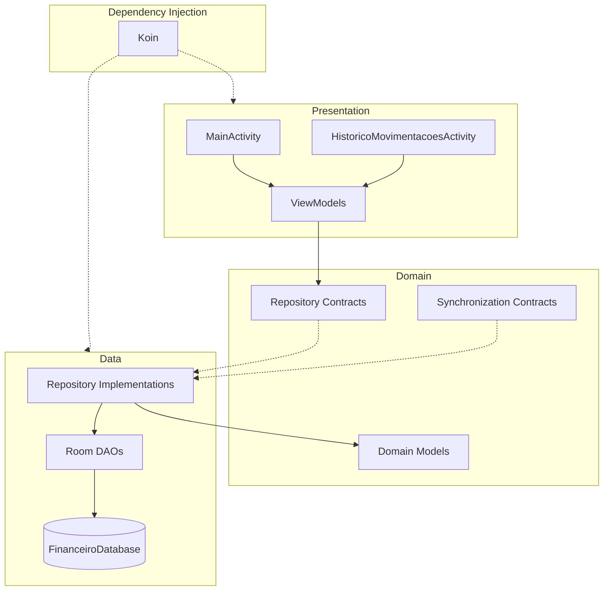
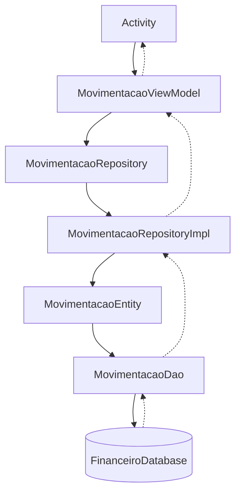

# Arquitetura da Aplicação

[Português](#português) | [English](#english)

---

## Português

O Planejador Financeiro utiliza uma arquitetura organizada em camadas, buscando separar responsabilidades e facilitar a manutenção e evolução da aplicação.

### Visão geral

### Camadas

**Presentation**

Responsável pela interface e pelo gerenciamento dos estados apresentados ao usuário.

Componentes identificados:
- MainActivity
- HistoricoMovimentacoesActivity
- DashboardViewModel
- ContaViewModel
- MovimentacaoViewModel

**Domain**

Concentra os modelos de negócio e os contratos utilizados pela aplicação.

**Data**

Responsável pelas implementações dos repositórios e pela persistência local utilizando Room.

**Dependency Injection**

O Koin gerencia as dependências da aplicação por meio de módulos específicos para banco de dados, repositórios e ViewModels.

### Persistência

O aplicativo utiliza Room como solução de persistência local.

O FinanceiroDatabase centraliza o acesso aos DAOs e utiliza migrações para preservar os dados durante a evolução do esquema do banco.

### Injeção de dependências

A configuração do Koin é inicializada em FinanceiroApplication, registrando os módulos:

- DatabaseModule
- RepositoryModule
- ViewModelModule

### Fluxo de dados

O fluxo de cadastro e atualização de movimentações segue esta sequência:

1. A Activity recebe os dados da interface.
2. O ViewModel valida e processa as informações.
3. O Repository recebe o modelo de domínio.
4. A implementação do Repository converte o modelo para uma Entity.
5. O DAO executa a operação no banco Room.
6. Os dados observados por Flow são propagados para a camada de apresentação.

### Estado da sincronização

A aplicação possui contratos e uma implementação de orquestração para sincronização de contas, movimentações e exclusões pendentes.

O mecanismo utiliza StateFlow para expor seu estado e Mutex para evitar execuções simultâneas.

**Pendências de integração identificadas:**

- Implementação concreta de SincronizacaoDataSource.
- Registro de SincronizacaoRepository no módulo de injeção de dependências.
- Integração da sincronização com a fonte externa de dados.

A integração externa não é considerada concluída nesta versão da documentação.

---

## English

Planejador Financeiro uses a layered architecture designed to separate responsibilities and improve maintainability and scalability.

### Overview

The application is organized into four main areas:

- **Presentation:** user interface and presentation state management.
- **Domain:** business models and repository contracts.
- **Data:** repository implementations and local persistence.
- **Dependency Injection:** dependency management using Koin.

### Persistence

The application uses Room for local data persistence.

FinanceiroDatabase centralizes DAO access and manages database schema migrations.

### Dependency Injection

Koin is initialized through FinanceiroApplication and configured using dedicated modules for database, repositories, and ViewModels.
